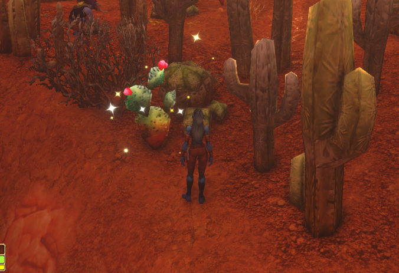

# QuestGlow Forever

Spot collectible quest objects as you explore Azeroth. QuestGlow Forever turns on the game's golden sparkles when you log in, so objects like the Cactus Apple are easier to see among nearby plants and scenery.

## How it works

- Built for World of Warcraft: Forever (1.60.1).
- Applies the sparkle settings automatically at login.
- Switches off graphics outlines so the game's sparkle effect can appear on eligible objects.
- Use `/questglow off` to restore your previous settings before uninstalling. Use `/questglow on` to enable sparkles again. Restart WoW if the visual effect hasn't refreshed.

## About the author

Developed by **Denis Aleksandrov** at **Razer Dev Studio**, publishing as **Sobstven** on CurseForge.

## Support development & join the community

QuestGlow Forever is free to download and use. If it helps you, you can support development, testing, and future updates on Patreon. Feedback and bug reports are welcome on Discord or GitHub.

- [Support on Patreon](https://www.patreon.com/c/DenisAleksandrov/membership)
- [Join the Discord](https://discord.gg/Pr5eMAUqt)
- [Source code and issues](https://github.com/sobata1995-source/QuestGlowForever)
- [More addons by Sobstven](https://www.curseforge.com/members/sobstven/projects)
